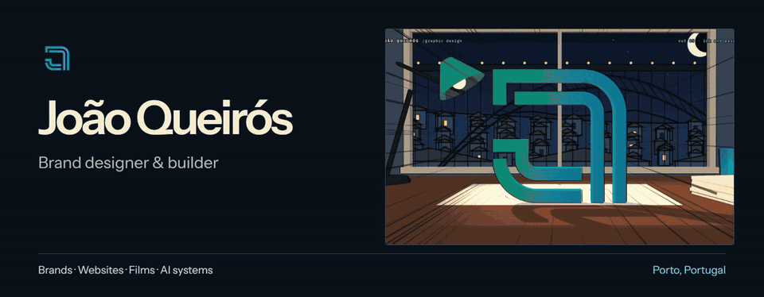

# I'm João Queirós

A brand designer and builder based in Porto. I create brand identities, websites, product films and AI systems.

<a href="https://www.joaoqueiros.com/"><picture><source media="(prefers-reduced-motion: reduce)" srcset="assets/profile/joao-queiros-banner.png"></picture></a>

[Static banner](assets/profile/joao-queiros-banner.png)

## Find the right work

| Looking for… | Start here |
|---|---|
| Brand identity and logo design | [João Queirós](https://www.joaoqueiros.com/) |
| Website design and development | [Scrollwork](https://www.ai.joaoqueiros.com/scrollwork) |
| SEO audits and ongoing checkpoints | [Cairn](https://www.ai.joaoqueiros.com/cairn) |
| AI automation and business systems | [JQ AI SYSTEMS](https://www.ai.joaoqueiros.com/) |
| Creative coding, films and reusable examples | [Visions Recipes](https://github.com/jqaisystems/visions-recipes) |

## Selected work

- **[Scrollwork](https://www.ai.joaoqueiros.com/scrollwork):** brand-led websites, designed and built to move with the scroll. [Breakdown](https://github.com/jqaisystems/jqai-internal-systems/blob/main/case-studies/scrollwork.md).
- **[Cairn](https://www.ai.joaoqueiros.com/cairn):** SEO audits and four-week checkpoints, with a written decision at each stage. [Breakdown](https://github.com/jqaisystems/jqai-internal-systems/blob/main/case-studies/cairn.md).
- **[Visions Recipes](https://github.com/jqaisystems/visions-recipes):** films made in code, with prompts, remix notes and source you can explore.
- **[JQ AI Skills](https://github.com/jqaisystems/jqai-ai-skills):** reusable workflows with instructions, examples and a guided installation path.

[More case studies](https://github.com/jqaisystems/jqai-internal-systems) · [Guided demos](https://github.com/jqaisystems/jqai-public-demos)

Have a project in mind? **[Start a conversation](https://www.ai.joaoqueiros.com/contact)**.
