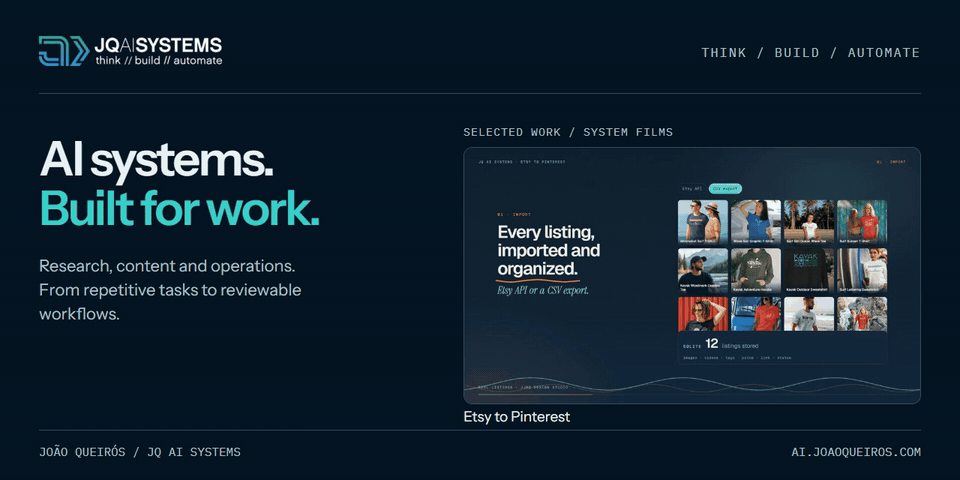

# Hi, I'm João

Founder of [JQ AI SYSTEMS](https://www.ai.joaoqueiros.com). I build AI systems that turn repetitive research, content and operations work into workflows people can review and run.

Built for studios, consultants and small teams.

[Selected work](#selected-work) · [Try the demos](https://github.com/jqaisystems/jqai-public-demos) · [AI skills](https://github.com/jqaisystems/jqai-ai-skills) · [Discuss a project](https://www.ai.joaoqueiros.com/contact)

<a href="https://www.ai.joaoqueiros.com/systems"><picture><source media="(prefers-reduced-motion: reduce)" srcset="assets/profile/jqai-systems-workspace-hero.png"></picture></a>

[Static preview](assets/profile/jqai-systems-workspace-hero.png) · [Explore the systems](https://www.ai.joaoqueiros.com/systems)

## Selected work

### Etsy to Pinterest

Turn listings into Pinterest-ready content. Review and schedule image pins; prepare video pins in a separate manual queue.

[Case study](https://www.ai.joaoqueiros.com/systems/etsy-to-pinterest) · [Open demo](https://www.ai.joaoqueiros.com/demo/etsy-to-pinterest.html) · [Watch the film](https://www.ai.joaoqueiros.com/media/systems/films/etsy-to-pinterest.mp4)

### Adobe Stock Uploader

Read image batches, prepare ordered metadata, and validate the CSV before final human review and submission.

[Case study](https://www.ai.joaoqueiros.com/systems/adobe-stock-uploader) · [Open demo](https://www.ai.joaoqueiros.com/demo/adobe-stock-uploader.html) · [Watch the film](https://www.ai.joaoqueiros.com/media/systems/films/adobe-stock-uploader.mp4)

### SEO Engine

Bring indexing checks, sitemap validation and dated search checkpoints into a repeatable operating routine.

[Case study](https://www.ai.joaoqueiros.com/systems/seo-engine) · [Watch the film](https://www.ai.joaoqueiros.com/media/systems/films/seo-engine.mp4) · [Public breakdown](https://github.com/jqaisystems/jqai-internal-systems/blob/main/case-studies/seo-engine.md)

The film excerpts explain the workflows visually. Open the linked demos for guided interfaces using sample data.

## Open-source tools

| Project | Start here |
|---|---|
| [JQ AI Skills](https://github.com/jqaisystems/jqai-ai-skills) | Portable, MIT-licensed instruction folders for Codex and Claude Code. [Browse the catalog](https://github.com/jqaisystems/jqai-ai-skills/blob/main/docs/catalog.md), [inspect examples](https://github.com/jqaisystems/jqai-ai-skills/blob/main/docs/examples/public-proof-index.md), or read the [latest release](https://github.com/jqaisystems/jqai-ai-skills/releases/latest). |
| [Codex Control Center](https://github.com/jqaisystems/codex-control-center) | Local observability and workflow review for Codex. [Try the sample-data demo](https://jqaisystems.github.io/codex-control-center/demo/). |
| [OutreachIQ](https://github.com/jqaisystems/outreachiq) | Lead research, drafting, tone checks and a human review gate. [Explore the product](https://www.outreachiq.joaoqueiros.com/). |
| [Thumbnail Studio](https://github.com/jqaisystems/thumbnail-studio) | A local workspace for thumbnail options, comparison and export. [Explore the product](https://www.ai.joaoqueiros.com/thumbnailstudio). |

How I build and what you can inspect

I work with Codex, Claude Code, Python/FastAPI, PHP, SQLite and automation APIs, choosing the tools around the workflow.

The [case-study repository](https://github.com/jqaisystems/jqai-internal-systems) explains the problem, workflow and review points. The [demo gallery](https://github.com/jqaisystems/jqai-public-demos) lets you explore the public walkthroughs. Client data, credentials and private implementation details stay private.

## Have a workflow in mind?

[Discuss a project](https://www.ai.joaoqueiros.com/contact) or explore the [full website](https://www.ai.joaoqueiros.com).

[LinkedIn](https://www.linkedin.com/company/jq-ai-systems/) · [X](https://x.com/joaojbqueiros) · Porto, Portugal
